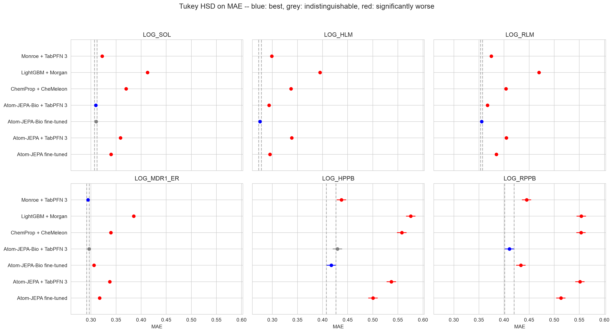

# atom-jepa-bio

[Atom-JEPA-Bio](https://mjordahn.github.io/atom-jepa-website/atom-jepa-bio.html)
adds a second pre-training stage to the released Atom-JEPA `molecules` encoder,
a 39 M-parameter EquiformerV3. Stage 2 keeps the self-supervised
latent-prediction objectives and adds a supervised focal loss over 1,089 PCBA
bioassays on about 1.5 M molecules. The PCBA data are prepared with Monroe's own
pipeline, which holds out the Polaris and MoleculeACE test splits.

The architecture and the ADMET fine-tuning recipe are unchanged from the
[atom-jepa](../atom-jepa/README.md) study. The authors evaluated it on this
repository's protocol with their own reimplementation of it. They report it
best or tied on 34 of 45 endpoint × metric combinations, against 18 for
Monroe + TabPFN 3.

Only the encoder weights differ from the atom-jepa study, so this study can
answer one question cleanly: what does the bioassay stage buy? The recipe,
folds and fine-tuning code stay the same, and one checkpoint is swapped.

The authors' count reproduces to within one. Tukey over the same six arms as
their tables puts fine-tuned Bio on top of 35 of 45 combinations (21 of 27 on
ExpansionRx, 14 of 18 on Biogen), against their 34. Monroe is on top of 17,
against their 18.

The bioassay stage helps, most on Biogen. Paired by fold, fine-tuned Bio
against fine-tuned stage-1 Atom-JEPA:

| | Ahead | No call | Behind | Median ΔR² |
| --- | --- | --- | --- | --- |
| ExpansionRx, 27 | 14 | 12 | 1 (MGMB MAE, by 0.005) | +0.024 |
| Biogen, 18 | 18 | 0 | 0 | +0.067 |

Frozen and read by TabPFN 3, the stage helps more: a median +0.057 R² on
ExpansionRx and +0.109 on Biogen, ahead on 37 of 45 combinations.

Against Monroe + TabPFN 3, fine-tuned Bio:

| | Ahead | No call | Behind | Stage 1 was |
| --- | --- | --- | --- | --- |
| ExpansionRx, 27 | 18 | 2 | 7 | 18 ahead, 9 behind |
| Biogen, 18 | 12 | 3 | 3 | 3 ahead, 13 behind |

It still loses MLM and Caco-2 on ExpansionRx and MDR1 ER on Biogen, all
endpoints where stage 1 lost. On Caco-2 A→B Monroe's R² is 0.47, against 0.28
for Bio.

Two checks:
- **The machine:** re-training stage 1 on mercury, Biogen repeat 0, lands within
  0.007 R² of the imported folds on every endpoint. Bio is at least 0.039
  above them.
- **PCBA exposure:** on the 85% of Biogen test molecules PCBA does not
  contain, Bio still has lower MAE than stage 1 on all six endpoints. It also
  beats Monroe on four: SOL, HLM, RLM and HPPB. The molecules PCBA does contain
  are harder for every arm, not easier.

The report is at
[docs/reports/atom-jepa-bio.html](../../docs/reports/atom-jepa-bio.html), or on
the [web](https://patwalters.github.io/model-validation-central/reports/atom-jepa-bio.html).



## What was compared

| Method | What it is | Where it comes from |
| --- | --- | --- |
| `lgbm` | LightGBM on Morgan counts, the floor | imported |
| `chemprop_st`, `chemprop` | the two from-scratch D-MPNN reference arms | imported, for the site overview only |
| `chemeleon` | multitask D-MPNN initialised from CheMeleon, fine-tuned | imported |
| `monroe` | Monroe's frozen embedding read by TabPFN 3 | imported |
| `atomjepa_ft` | stage-1 Atom-JEPA fine-tuned, from the atom-jepa study | imported |
| `atomjepa_tabpfn` | the frozen stage-1 encoder read by TabPFN 3 | refitted here, `03_run_tabpfn.py` |
| `bio_tabpfn` | the frozen Bio encoder read by the same TabPFN 3 call | fitted here, `03_run_tabpfn.py` |
| `bio_ft` | the paper's arm: the Bio encoder fine-tuned with the authors' code | fitted here, `04_run_finetune.py` |

The pairs that answer the question:
- **`bio_ft` against `atomjepa_ft`:** the bioassay stage, with fine-tuning.
- **`bio_tabpfn` against `atomjepa_tabpfn`:** the bioassay stage, frozen. Both
  run here, with the same conformers, machine and library versions.
- **`bio_ft` and `bio_tabpfn` against `monroe`:** the paper's headline
  comparison. Monroe's pre-training uses the same PCBA preparation.

`atomjepa_tabpfn` is refitted rather than imported so that the two frozen arms
share everything except the checkpoint. It reproduces the imported one to
within 0.004 R² on every endpoint.

## The fine-tuned arm is the authors' code

Nothing is reimplemented:
- **Code:** `04_run_finetune.py` calls `train_multitask` from
  [khelverskovp/atom-jepa](https://github.com/khelverskovp/atom-jepa) at commit
  `64d539b`. The fine-tuning configs at that commit are identical to `bab0853`,
  the commit the atom-jepa study ran.
- **Weights:** the `bio/` encoder from
  [atom-jepa/atom-jepa](https://huggingface.co/atom-jepa/atom-jepa), loaded with
  `from_pretrained("bio")` at Hub revision `bf14d02`.
- **Recipe and overrides:** these are the atom-jepa study's, `FINETUNE_OVERRIDES`
  in `config.py`: 50 epochs, the encoder frozen for 10 and ramped in over 10,
  multitask Huber with Kendall weighting, 10 conformers per molecule, test
  predictions averaged over all 10. See that study's README for the full table.

From `ed49115` on, `train_multitask` returns its metrics as device tensors.
`04_run_finetune.py` converts them before writing each fold's diagnostics JSON.

## A machine check

The imported `atomjepa_ft` was trained on apollo and spark, while `bio_ft` is
trained mostly on mercury. To find out how much the machine change alone moves
fine-tuning, `atomjepa_ft_rerun` re-trains the stage-1 encoder on mercury for
Biogen repeat 0, five folds. Those folds are compared with the imported ones,
and the Bio margin is reported against both.

## The conformers are the atom-jepa study's

RDKit's ETKDG with a fixed seed does not give the same conformers across RDKit
releases. mercury's RDKit 2026.09.1 and apollo's 2026.03.6 disagree on 1,255 of
3,521 Biogen molecules. Rebuilt conformers moved the frozen stage-1 arm by up
to 0.10 R² on HPPB and RPPB.

So this study uses the atom-jepa study's conformer caches as they are.
`01_conformers.py` checks their md5s (`CONFORMER_MD5` in `config.py`) and
refuses to rebuild unless `ATOMJEPA_ALLOW_NEW_CONFORMERS=1`. With the same
conformers, mercury reproduces apollo's frozen embeddings to a median 3e-7.

## Was it pre-trained on the test set?

Stage 2 trains on PCBA, and so does Monroe. `09_check_pcba_overlap.py` matches
every molecule here to the 1,328-assay PCBA table (Zenodo record 8024997). It
uses Monroe's own dedup key, standard InChI from datamol.

| | Test molecules in PCBA | Train molecules in PCBA |
| --- | --- | --- |
| ExpansionRx | 0 of 2,282 | 10 of 5,326 |
| Biogen | 162 of 1,058 (15.3%) | 394 of 2,463 |

These are upper bounds. Monroe's preparation moves the Polaris test splits of
the Biogen benchmarks out of training, and that hold-out cannot be reproduced
without a Polaris login. AID 1996, aqueous solubility, labels 12 Biogen test
molecules. The CYP panel labels about 10. The report splits the Biogen test set
on this flag.

## Running it

Two CUDA machines ran this:
- **mercury:** an RTX PRO 5000 Blackwell, 48 GB.
- **apollo:** an RTX 5070 Ti, 16 GB.

Both use Python 3.12, torch 2.14.1+cu130, e3nn 0.6.0 and cuEquivariance 0.12.0,
with `pip install -e "atom-jepa[all,cu13]"`. The TabPFN arms run in a `monroe`
environment with tabpfn 8.3, which loads TabPFN 3. The regressor checkpoint is
read from `~/.cache/tabpfn`, so no licence token is needed.

```bash
for ds in expansion biogen; do
  ADME_DATASET=$ds ADME_SOURCE_REPO=../kermt python 00_import_baselines.py
done
# copy the atom-jepa study's data/<ds>/conformers/*.pkl here first
nohup setsid ./run_atomjepa_bio.sh >> logs/atomjepa_bio.log 2>&1 < /dev/null &   # mercury
nohup setsid ./run_apollo.sh >> logs/apollo.log 2>&1 < /dev/null &               # apollo
```

The two machines split ExpansionRx:
- **mercury** works forwards.
- **apollo** works backwards (`--reverse`).
- **Claims:** each skips the folds listed in `folds/expansion/claimed_folds.txt`.
  A small loop on the workstation copies each machine's finished and running
  folds into the other's file.

Each fold's diagnostics record the host and GPU that ran it.

The analysis runs in any environment with `requirements.txt`:

```bash
python 09_check_pcba_overlap.py PCBA_1328_1564k.parquet --workers 12
for ds in expansion biogen; do
  ADME_DATASET=$ds python 05_collect_metrics.py
  ADME_DATASET=$ds python 06_report.py
done
python 07_summary.py       # calls, levers, re-run check, exposure, cost
python 08_build_page.py    # -> results/report.html and docs/reports/atom-jepa-bio.html
```

## What each phase costs

| Phase | Machine | Folds | Median per fold | Total |
| --- | --- | --- | --- | --- |
| Frozen embeddings + 750 TabPFN 3 fits | mercury | — | seconds | ~1 h |
| Bio fine-tuning, Biogen | mercury, RTX PRO 5000 | 25 | 12 min | 5.1 h |
| Stage-1 re-run check, Biogen | mercury, RTX PRO 5000 | 5 | 14 min | 1.1 h |
| Bio fine-tuning, ExpansionRx | mercury, RTX PRO 5000 | 12 | 35 min | 7.2 h |
| Bio fine-tuning, ExpansionRx | apollo, RTX 5070 Ti | 13 | 62 min | 13.5 h |

On the RTX 5070 Ti an ExpansionRx fold took 62 min. That is close to the 59 min
for stage 1 on the same card, since the recipe is the same. Bio's best epoch
came earlier on Biogen: a median 19 of 50, against 30 for stage 1.

## Licence

The study's code is MIT; see [LICENSE](LICENSE). The Atom-JEPA code is MIT and
its weights are CC BY 4.0. Neither is vendored here.
