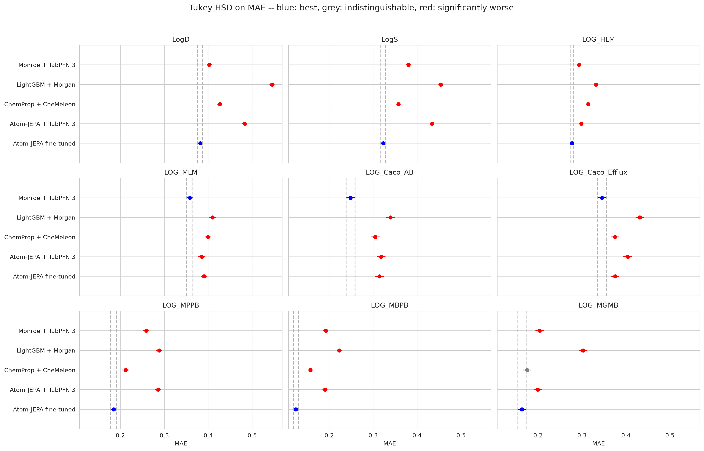

# atom-jepa

[Atom-JEPA](https://arxiv.org/abs/2610.08400) pre-trains a 39 M-parameter
EquiformerV3, an SE(3)-equivariant graph network, on 19 M Uni-Mol conformers.
It learns by predicting, in latent space, the representation of one part of a
molecule from another, both atom by atom and for whole substructures. For ADMET
the encoder is then fine-tuned, multitask, on ten RDKit conformers per
molecule. The paper reports it best or statistically tied on every ExpansionRx
and Biogen endpoint, against fingerprint models, Chemprop, KERMT and CKERMT.

This study runs the authors' own code and released weights on the same
molecules, folds and statistics as everything else in the repository. The
comparison includes the arm the paper did not run, Monroe + TabPFN 3.

The paper's claim against its own kind of comparator replicates. Fine-tuned
Atom-JEPA is significantly ahead of fine-tuned CheMeleon on 38 of 45 endpoint ×
metric combinations and behind on 2. It is ahead of LightGBM on Morgan counts on
all 45.

Against Monroe the two data sets disagree:

Counts of 27 and 18 below are endpoint × metric combinations: 9 or 6
endpoints, each scored on R², Spearman ρ and MAE.

- **ExpansionRx:** in paired tests fine-tuned Atom-JEPA is ahead of Monroe on 6
  of the 9 endpoints on all three metrics (LogD, LogS, HLM, MPPB, MBPB, MGMB)
  and behind on the other 3 on all three (Caco-2 A→B, Caco-2 efflux, MLM): 18
  ahead and 9 behind of 27 combinations. After Tukey's correction it is on top
  of 19 of the 27 to Monroe's 9.
- **Biogen:** it is behind Monroe on 4 of the 6 endpoints on all three metrics
  (SOL, MDR1 ER, HPPB, RPPB) and split on HLM and RLM: 3 ahead and 13 behind of
  18 combinations. After Tukey's correction Monroe is on top of 17 of the 18 and
  Atom-JEPA of 5.

Training-set size does not explain the split. The Spearman correlation between
molecules per fold and Atom-JEPA's margin over Monroe is −0.04 across the
fifteen endpoints.

The frozen arm separates the two halves of the method. Under the same TabPFN 3
call, Atom-JEPA's frozen embedding is behind Monroe's on 41 of 45 combinations
and ahead on none, a median −0.09 R² on both data sets. Fine-tuning then never
loses to freezing and adds a median +0.13 R² on ExpansionRx and +0.07 on
Biogen. That is enough to overtake Monroe on ExpansionRx and not on Biogen.
What the paper's arm wins, it wins through fine-tuning, not through what
pre-training put in the frozen encoder.

The report is at
[docs/reports/atom-jepa.html](../../docs/reports/atom-jepa.html), or on the
[web](https://patwalters.github.io/model-validation-central/reports/atom-jepa.html).
It is a standalone page, not one of the cards on the site index. This study has
no `study.json`, so `site/build_site.py` leaves it alone and it does not enter
the cross-study table. `08_build_page.py` publishes it directly.



## What was compared

| Method | What it is | Where it comes from |
| --- | --- | --- |
| `lgbm` | LightGBM on Morgan counts, the floor | imported |
| `chemprop_st`, `chemprop` | the two from-scratch D-MPNN reference arms | imported, for the site overview only |
| `chemeleon` | multitask D-MPNN initialised from CheMeleon, fine-tuned | imported |
| `monroe` | Monroe's frozen embedding read by TabPFN 3 | imported |
| `atomjepa_tabpfn` | Atom-JEPA's frozen embedding read by the same TabPFN 3 call | fitted here, `03_run_tabpfn.py` |
| `atomjepa_ft` | the paper's arm: the encoder fine-tuned with the authors' code | fitted here, `04_run_finetune.py` |

`atomjepa_tabpfn` is the control:
- **Against `monroe`:** it changes the representation and nothing else.
- **Against `atomjepa_ft`:** it changes how the encoder is used, frozen and read in
  context rather than trained.

## The fine-tuned arm is the authors' code

Nothing is reimplemented:
- **Code:** `04_run_finetune.py` calls `train_multitask` from
  [khelverskovp/atom-jepa](https://github.com/khelverskovp/atom-jepa) at commit
  `bab0853`, building its datasets with their `MultiTaskFinetuneDataset`.
- **Weights:** the `molecules` encoder from
  [atom-jepa/atom-jepa](https://huggingface.co/atom-jepa/atom-jepa) (CC BY 4.0),
  downloaded on first use.
- **Configuration:** Hydra composes their `conf/finetune_expansionrx.yaml` or
  `conf/finetune_biogen_adme.yaml`, whose values are the same.

The recipe is theirs and is not tuned here:

| Setting | Value |
| --- | --- |
| Model | one multitask model per fold over every endpoint; shared trunk, one 64-unit head per endpoint |
| Readout | mean-pooled l = 0 features plus per-atom norms of l = 1 and l = 2 |
| Loss | masked Huber on standardised targets, Kendall uncertainty weighting |
| Schedule | 50 epochs, encoder frozen for the first 10 and ramped in over the next 10, cosine to 1e-7 |
| Learning rate | encoder 5e-5, head 5e-4, batch 32 |
| Regularisation | L2-SP 1e-5, trunk weight decay 0.1, EMA 0.99 |
| Conformers | 10 per molecule; one drawn per molecule per epoch; the test prediction is the mean over all 10 |
| Precision | bf16 encoder, cuEquivariance kernels, compiled blocks |

The overrides, `FINETUNE_OVERRIDES` in `config.py`, change nothing that is
trained:

- **`log_transform_tasks=[]`.** The endpoints here are already log10(x + 1), or
  LogD as measured. The ExpansionRx default would apply `log1p` a second time.
- **`report_scale=null`.** That setting is a second set of metrics on raw assay
  units, which these data are not in. It never touches training.
- **`conformer_eval_mode=ensemble`.** Select and score on the conformer-averaged
  prediction, the one written to disk and the paper's "×10 conf" arm, rather
  than on the mean of per-conformer errors.
- **`save_best=false`, `save_last=false`.** The best-validation EMA weights are
  held in memory either way.
- **`seeds=[0]`, `plot_every=0`, `wandb.enabled=false`.** One model per fold,
  seeded per fold, and no logging.

## The split is ours

| Part | What it is | Used for |
| --- | --- | --- |
| train | the four fifths of `ds == 'train'` outside the held-out fold | fitting |
| validation | the held-out fifth | picking the best epoch, as the ChemProp arms use it for early stopping |
| test | every `ds == 'test'` molecule | scoring, the same set every arm is scored on |

A molecule enters an endpoint's loss only where it has a value for that
endpoint. An endpoint's predictions are written only for the test molecules
that have one, so the scored rows are exactly every other arm's.

The authors' dataset class drops molecules whose conformers fail, without
saying so. `04_run_finetune.py` refuses to run if any are dropped.
`01_conformers.py` refuses if any molecule gets no conformer. None did: 11,129
molecules, all embedded, 20 of them with fewer than ten conformers.

## The frozen arm

`02_embed.py` runs the encoder once over conformer 0 of each molecule, from the
same cache as the fine-tuned arm. It uses their package's
`embed(..., layers="all")`, which gives the l = 0 output of each of the eight
blocks, mean-pooled over all atoms: 2,048 features. That is the "all layers"
representation of the paper's frozen baselines, the better of its two frozen
variants on ExpansionRx.

It runs in fp32, as the authors' frozen baseline does. In fp32 the
cuEquivariance kernels reproduce plain PyTorch exactly. bf16 does not: the
difference compounds through the residual stream and moves the eighth block's
features by about 44%.

TabPFN 3 refuses more than 2,000 features. So in each fold the 48
lowest-variance columns are dropped, the variance taken on that fold's training
rows only, as the `molpair` study does. The call is then the `monroe` arm's
`fit_predict_tabpfn` with its `default_ensemble_specs` and `output_type="mean"`.

## Running it

Two CUDA machines ran this: apollo, an RTX 5070 Ti with 16 GB, and spark, a DGX
Spark (GB10, aarch64). Each uses an `atomjepa` environment built the same way
(Python 3.12, torch 2.14.1+cu130, `pip install -e "atom-jepa[all,cu13]"`, which
pulls cuEquivariance 0.12):

```bash
# The molecule table, the folds and the imported arms, from the source study
for ds in expansion biogen; do
  ADME_DATASET=$ds ADME_SOURCE_REPO=~/MOLPAIR_SOURCE python 00_import_baselines.py
done

nohup ./run_atomjepa.sh >> logs/atomjepa.log 2>&1 &   # conformers, embeddings, TabPFN, fine-tuning
```

The TabPFN arm runs in the `monroe` environment, where tabpfn 8.3 loads TabPFN 3.
Each fold is a resume point.

To split a sweep across machines:
- **Claiming folds:** list `repeat fold` pairs in
  `folds/<ds>/claimed_folds.txt` and that machine skips them. The file is
  re-read before every fold.
- **Reverse order:** `--reverse` walks the folds from the last, so two machines
  started at opposite ends meet in the middle.
- **Markers:** a fold in progress leaves `diagnostics/<ds>/running_r<r>_f<f>`.

ExpansionRx was split that way:
- **apollo:** 17 folds, forwards.
- **spark:** 8 folds, backwards, with `ATOMJEPA_NUM_WORKERS=0`.

No fold was trained twice. Each fold's diagnostics record the host and GPU that
ran it.

Two machine-specific problems, neither of which changes what is trained:

- **apollo's `/usr/local/bin/openssl` does not load its libraries.** torch.compile
  shells out to it, so `run_atomjepa.sh` puts the environment's `bin` first on
  `PATH`.
- **On spark the data loader deadlocks** when it forks workers after
  cuEquivariance has started its threads. With `ATOMJEPA_NUM_WORKERS=0` batches
  are built in the main process. That changes which random conformer a training
  step draws, since the draw is a `torch.randint` inside `__getitem__`, and
  nothing else.

The report runs in any environment with `requirements.txt` (`ptgin` on
apollo):

```bash
for ds in expansion biogen; do
  ADME_DATASET=$ds python 05_collect_metrics.py     # -> fold_metrics.csv
  ADME_DATASET=$ds python 06_report.py              # Tukey, paired, delta figures
done
python 07_summary.py                                # calls, levers, size, cost
python 08_build_page.py    # -> results/report.html and docs/reports/atom-jepa.html
```

## What each phase costs

| Phase | Machine | Folds | Median per fold | Total |
| --- | --- | --- | --- | --- |
| Conformers, both sets | apollo, CPU | — | — | 3 min |
| Frozen embeddings + 375 TabPFN 3 fits | apollo | 375 | seconds | ~20 min |
| Fine-tuning, Biogen | apollo, RTX 5070 Ti | 25 | 20 min | 8.3 h |
| Fine-tuning, ExpansionRx | apollo, RTX 5070 Ti | 17 | 59 min | 17.2 h |
| Fine-tuning, ExpansionRx | spark, GB10 | 8 | 155 min | 20.7 h |

Peak GPU memory was 14.2 GB on Biogen and 11.4 GB on ExpansionRx. The best
epoch, picked on the held-out fifth, had a median of 30 of 50 on Biogen and 37
on ExpansionRx. After it, training loss kept falling while validation MAE rose.

## Licence

The study's code is MIT; see [LICENSE](LICENSE). The Atom-JEPA code is MIT and
its weights are CC BY 4.0. Neither is vendored here: the checkout and the Hub
download happen on the GPU machine.
