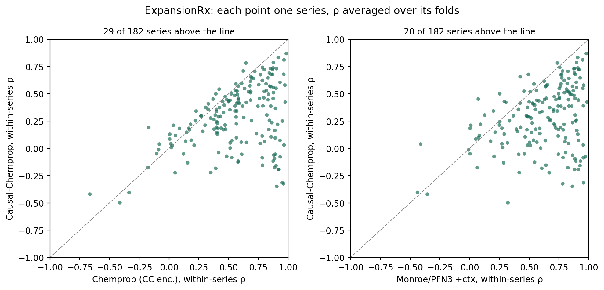

# causal-chemprop

[Causal-Chemprop](https://doi.org/10.1021/acs.jcim.6c01429) (Natajaya, Attia,
Burns and Doyle, *J. Chem. Inf. Model.* 2026) puts a structural causal model
(SCM) on top of a trained Chemprop:
- **The variables:** the 200-unit last hidden layer of the feed-forward network
  and the target, 201 in all.
- **The graph:** DAGMA learns a linear DAG over them from an *analog set*, the
  training molecules whose Murcko scaffold resembles the series being predicted.
- **The mechanisms:** dowhy's GCM fits one to every node and scores each node's
  intrinsic causal contribution (ICC) to the target.
- **Inference:** one member of the series, the *anchor*, is measured. Its noise
  is abducted, each other member's values are imposed on the high-ICC nodes, and
  the counterfactual target is the prediction.

The paper reports better within-series ranking than Chemprop on eleven ABL1,
AURKA and SRC scaffold groups.

This study runs the authors' own code in two settings:
- **The paper half:** the paper's eleven tasks, from their release.
- **The protocol half:** ExpansionRx and Biogen, on the same molecules, folds
  and statistics as everything else in the repository, with series and anchors
  defined the paper's way.

It is compared with Monroe + TabPFN 3, fine-tuned Atom-JEPA, CheMeleon,
LightGBM, and the Chemprop encoder Causal-Chemprop is built on.

**The paper half.** With the released checkpoints the paper reproduces:
- **Table 1:** 65 of 66 values to two decimals.
- **Against Chemprop:** ahead of the released Chemprop on 9 of the 11 tasks.

It does not survive retraining. Refit end to end through the authors' own
seeded, deterministic `train`, Causal-Chemprop loses within-task Spearman ρ on
10 of 11 tasks, ties on the eleventh and gains on none (Wilcoxon p = 0.005).
The paper's result belongs to its particular checkpoints.

**The protocol half.** Causal-Chemprop is fitted per fold and per series. Its
within-series Spearman ρ is behind:
- **Its own encoder** on 152 of 182 ExpansionRx series and 20 of 22 Biogen ones.
- **Monroe + TabPFN 3** on 159 of 182 and 22 of 22.

Every series-level comparison has Wilcoxon p < 0.001. After Tukey's correction
over folds it is on top of 0 of 8 ExpansionRx endpoints on within-series ρ, and
of 1 of 4 Biogen endpoints, LOG_SOL, where every interval is wide.

**Why.** The fit diagnostics locate the loss.
- **Counterfactual predictions:** when every member of a series gets the
  counterfactual, the within-series ρ is −0.02 on ExpansionRx and 0.12 on
  Biogen. Its encoder reaches 0.65 and 0.69 on the same series.
- **Plain SCM predictions:** when the authors' rules fall back to the SCM's
  plain prediction, Causal-Chemprop ranks about as well as the encoder.

The counterfactual pulls the series towards the anchor and does not keep its
order.

The report is at
[docs/reports/causal-chemprop.html](../../docs/reports/causal-chemprop.html), or
on the
[web](https://patwalters.github.io/model-validation-central/reports/causal-chemprop.html).
`11_build_page.py` publishes the page directly.



## What was compared

### The protocol half

| Method | What it is | Where it comes from |
| --- | --- | --- |
| `lgbm` | LightGBM on Morgan counts | imported from `expansion-ml-comparison` |
| `chemeleon` | multitask D-MPNN initialised from CheMeleon, fine-tuned | imported |
| `monroe` | Monroe's frozen embedding read by TabPFN 3 | imported |
| `atomjepa_ft` | Atom-JEPA fine-tuned with the authors' code | imported from `atom-jepa` |
| `cc_chemprop` | the authors' Chemprop recipe on the fold, ordinary inference: the encoder Causal-Chemprop sits on | fitted here, `03_train_encoder.py` |
| `causal_chemprop` | the authors' SCM on that encoder, one per series per fold | fitted here, `04_run_causal.py` |
| `monroe_anchor` | Monroe + TabPFN 3 with every series' anchor added to the in-context training set | fitted here, `06_run_monroe_anchor.py` |
| `<arm>_offset` | an unanchored arm shifted per series by its own error on the anchor | derived, `08_collect_metrics.py` |
| `anchor_value` | every member predicted at its anchor's measured value | derived; pooled metrics only |

The offset is the paper's "direct residual correction" and the cheapest use of
an anchor there is. It moves a whole series by a constant, so an arm and its
twin have the same within-series ρ and differ only in pooled R², pooled ρ and
MAE.

### The paper half

| Arm | What it is |
| --- | --- |
| `causal_chemprop`, `chemprop`, `chemprop_retrained` | the three released arms of Table 1, through the authors' `train` and `test_*` |
| `causal_refit_scm` | the released encoder, SCM refitted by their `train(fit_causal=True)` |
| `causal_refit_all` | encoder and SCM both refitted by their `train(fit_mcmpnn=True, fit_causal=True)` |
| `lgbm`, `lgbm_anchor` | LightGBM on Morgan counts, without and with the anchor in training |
| `monroe`, `monroe_anchor` | Monroe + TabPFN 3, without and with the anchor in context |
| `atomjepa_ft` | Atom-JEPA fine-tuned with its Biogen recipe |

Each arm trains on the task's training file. `atomjepa_ft` early-stops on the
same 80:20 split the authors' `train` makes (astartes, seed 8675309). The
`_offset` twins are formed the same way, and the metric is the paper's:
Pearson r and Spearman ρ over the non-anchor molecules of each task.

## The authors' code

The code is from [neopolyai/causal_chemprop](https://github.com/neopolyai/causal_chemprop)
at commit `a844c61`. The data and the trained models come from the
[Zenodo record](https://zenodo.org/records/18197047), unpacked into the checkout
as its README says.

`01_reproduce_paper.py` imports their `causal_utils` and calls `train`,
`test_regular`, `test_counterfactual` and `data_similarity` unchanged. It works
on two private copies of the checkout, one for the released arms and one for
the refits, because `train(fit_causal=True)` overwrites the released SCM pickle
in place.

For ExpansionRx and Biogen, `cc_kit.py` is the same two functions with the file
reading replaced by data frames. The model class, DAGMA, the vendored dowhy
GCM and Chemprop 2.0.0 are all imported, not copied. What differs from `train`:

| | The release | Here |
| --- | --- | --- |
| Validation split | random 80:20 of the training file | the protocol's held-out fifth, the same molecules every early-stopped arm in the repository stops on |
| Encoder hardware | CPU | GPU, `torch.use_deterministic_algorithms` off; seeds set |
| SCM hardware | CPU | CPU, one thread and one process per series-fold |

Inference is `test_counterfactual` line for line, including its three exits:
- **The counterfactual.**
- **The switch:** the SCM's plain prediction, per molecule, when
  `interv_diff > THRESHOLD · counter_diff`.
- **The low-variance fallback:** all plain predictions, when the series'
  predictions have variance below 0.005.

The ICC threshold is eq 10 of the paper, `max(0.5, min(2.5 · sim, 1))`. When no
node clears it, the release's own fallback picks the nodes. The fit records
that as `degenerate`.

### Hyperparameters

The release hard-codes the SCM settings per task, but the paper describes one
rule. Where the eleven tasks disagree, the majority value is used, fixed for
every series:

| Setting | Release | Here |
| --- | --- | --- |
| DAGMA L1, `LAMBDA` | 0.001 on 7 tasks, 0.002 on 4 | 0.001 |
| `W_THRESHOLD` | 0.3 on all 11 | 0.3 |
| DAGMA stages, `T` | 5 on all 11 | 5 |
| switch ratio, `THRESHOLD` | 4 on 6 tasks, 2 on 5 | 4 |
| FFN layers | 3 | 3 |
| Encoder | depth 6, hidden 200, dropout 0.2, batch norm, Noam 5e-5 / 5e-4 / 1e-5, batch 128, ≤ 200 epochs, patience 20 | the same |

## Series, anchors and analogs

`02_make_series.py` defines them.

- **Series:** a held-out test cluster (the repository's BitBIRCH clusters) with
  at least seven measured molecules for the endpoint. Seven is the paper's floor
  for a scaffold group.
- **Anchor:** one seeded-random member (`ANCHOR_SEED`, keyed by endpoint and
  cluster). Every anchor-aware arm gets it; the rest of the series is scored.
- **Analog set:** the fold's training molecules whose Murcko scaffold has ECFP4
  Tanimoto ≥ 0.25 to the anchor's scaffold. This is the authors'
  `find_similar_scaffolds_diverse_decorators` rule; the vectorised version is
  checked against theirs.
- **Feasible:** at least 90 analogs in every fold. Below about 90, the paper
  calls the 201-node SCM under-determined.

| Data set | Endpoints with a feasible series | Series | Scored molecules |
| --- | --- | --- | --- |
| ExpansionRx | LogD 51, LogS 46, MLM 21, Caco-2 efflux 20, Caco-2 A→B 18, HLM 12, MPPB 8, MBPB 6 | 182 | 5,363 |
| Biogen | HLM 8, RLM 6, MDR1 ER 6, SOL 2 | 22 | 164 |

MGMB, HPPB and RPPB have no feasible series. Every arm is scored on exactly the
same molecules.

## Statistics

`08_collect_metrics.py` writes two kinds of statistic:
- **Per fold, pooled** over every scored molecule: R², Spearman ρ and MAE, the
  protocol's three. Also the mean over series of the within-series Pearson r and
  Spearman ρ, the paper's metric.
- **Per series** in each fold: the within-series r, ρ and MAE.

`10_report.py` runs Tukey HSD per endpoint over folds, and paired t-tests on the
folds. It adds the comparison on the paper's terms: each series' ρ averaged over
its folds, with Causal-Chemprop against each arm by a Wilcoxon signed-rank test
over series. `09_paper_metrics.py` does the same over the eleven paper tasks.

## Deviations, and what was not run

- **One repeat.** Each series-fold is a separate SCM fit. A median fit takes 3.5
  to 85 minutes, by endpoint, and the longest takes 9.5 hours, so Causal-Chemprop is run on
  the five folds of repeat 0 only.
  - Every arm is restricted to those five folds.
  - The series-level counts are lopsided enough that more folds would not
    change their direction.
  - Encoders for all 25 folds exist (`run_encoders.sh`). `run_causal.sh <ds> <workers>`
    with no repeat argument runs the rest.
- **The missing-target fallback.** In 1 of the 1,020 fits DAGMA kept no edge
  into the target. The authors' code then raises `NodeNotFound`. That fit
  predicts with the plain encoder and is flagged `no_target_node`.
- **ABL1_0's SCM refit** was the first refit run, before dowhy GCM was pinned to
  one process (`n_jobs=-1` there, 1 everywhere else). It also predates the
  `role` column, which was added to its file afterwards from the released arm's
  anchor row. Its Pearson r is 0.891 against the released 0.895.
- **Table 1's one mismatch.** The retrained Chemprop on ABL1_2 gives ρ −0.08;
  the paper prints 0.08. The r matches (−0.04), so it looks like a dropped minus
  sign.
- **Atom-JEPA on the paper's tasks.** It used the `finetune_biogen_adme` recipe
  with the `molecules` checkpoint, with `mtl_loss=false` because there is one
  task.
  - The four AURKA tasks each lose five training molecules for which RDKit makes
    no conformer. No test molecule was lost; the script refuses if one is.
  - The three SRC tasks, about 2,500 molecules each, ran out of the 16 GB on
    apollo and were run on spark with `ATOMJEPA_NUM_WORKERS=0`.

## Running it

Two machines ran the sweep:
- **apollo:** 32 cores, an RTX 5070 Ti with 16 GB.
- **spark:** a DGX Spark, GB10, aarch64, 20 cores.

The `causalcp` environment is the authors' `environment.yml` with these changes:
- **torch:** 2.7.1+cu128, for the GPU.
- **Extra packages:** cclib, guacamol and tensorboard, which `causal_utils`
  imports.
- **rdkit on spark:** from pip, since no aarch64 conda build of 2024.3.6 exists.

torch ≥ 2.6 refuses the release's pickled checkpoints under `weights_only`. The
scripts therefore set `TORCH_FORCE_NO_WEIGHTS_ONLY_LOAD=1`, which extends the
same trust to the release that loading it under torch 2.5 would.

```bash
# The molecule table, folds, Monroe's embedding and the imported arms
for ds in expansion biogen; do
  ADME_DATASET=$ds ADME_SOURCE_REPO=~/ATOM_JEPA ATOMJEPA_REPO=~/ATOM_JEPA \
    MONROE_EMBED_REPO=~/EXPANSION_ML_COMPARISON python 00_import_baselines.py
  ADME_DATASET=$ds python 02_make_series.py
done

# The paper half
python 01_reproduce_paper.py                       # the released arms
python 01_reproduce_paper.py --refit scm all       # the two refits, hours per task
python 05_paper_arms.py                            # monroe env: Monroe and LightGBM arms
./run_paper_atomjepa.sh                            # atomjepa env
python 09_paper_metrics.py

# The protocol half
nohup ./run_encoders.sh >> logs/encoders.log 2>&1 &
nohup ./run_causal.sh expansion 20 0 >> logs/causal_expansion.log 2>&1 &
nohup ./run_causal.sh biogen 16 0 >> logs/causal_biogen.log 2>&1 &
ADME_DATASET=expansion python 06_run_monroe_anchor.py    # monroe env
ADME_DATASET=biogen python 06_run_monroe_anchor.py
for ds in expansion biogen; do
  ADME_DATASET=$ds python 04_run_causal.py --repeat 0 --assemble-only
  ADME_DATASET=$ds python 08_collect_metrics.py
  ADME_DATASET=$ds python 10_report.py
done
python 11_build_page.py   # -> results/report.html and docs/reports/causal-chemprop.html
```

The SCM sweep is single-threaded by design: it sets `OMP_NUM_THREADS=1`, runs
dowhy GCM with `n_jobs=1`, and hides CUDA from the workers. DAGMA with a
multithreaded BLAS runs 80 times slower when many fits share a machine.

Each series-fold is a resume point (`work/causal_parts/<ds>/`). A `.claim`
file names the machine running it.

To split the sweep across machines:
- **Start:** run one runner per machine, the second with `--reverse`.
- **Relay:** if the machines cannot reach each other, `sync_parts.sh` merges
  parts and claims through a third machine that can reach both.
- **Collect:** once the parts are together, `--assemble-only` writes the fold
  files.

## What each phase costs

| Phase | Machine | Work | Total |
| --- | --- | --- | --- |
| Encoders, repeat 0 | apollo, RTX 5070 Ti, three at a time | 60 fold models | 5 GPU h |
| SCM sweep, ExpansionRx | apollo + spark, one core per fit | 910 fits, median 3.5–31 min by endpoint, longest 9.5 h | 331 core h |
| SCM sweep, Biogen | apollo + spark | 110 fits, median 51–85 min by endpoint, longest 8.4 h | 196 core h |
| Paper refits | apollo, CPU | 22 refits | hours per task |
| Atom-JEPA, paper tasks | apollo, then spark for SRC | 11 fits | 10 GPU h |
| Monroe + anchors | apollo | 300 fold fits | about 2 h |

## Licence

The study's code is MIT; see [LICENSE](LICENSE). The Causal-Chemprop checkout
carries no licence file, and neither its code nor its data and checkpoints are
vendored here. They stay on the GPU machine, downloaded from GitHub and Zenodo.
