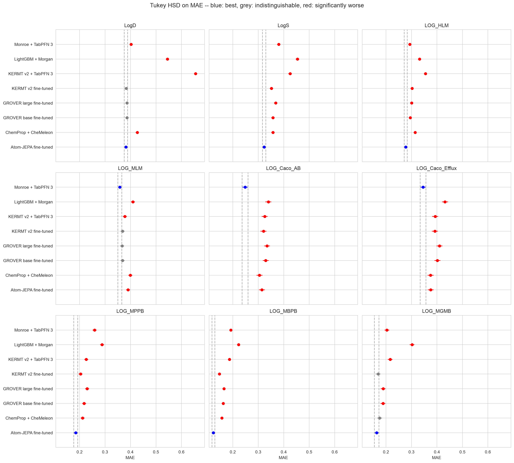

# kermt

[KERMT](https://github.com/NVIDIA-BioNeMo/KERMT) is NVIDIA's GPU-optimised
reimplementation of [GROVER](https://proceedings.neurips.cc/paper/2020/hash/94aef38441efa3380a3bed3faf1f9d5d-Abstract.html)
(Rong *et al.*, NeurIPS 2020), a dual-view graph transformer pre-trained on 11M
unlabelled molecules by predicting masked subgraph motifs. The released checkpoint,
[`NV-KERMT-70M-v2`](https://huggingface.co/nvidia/NV-KERMT-70M-v2), re-pretrains that
encoder with a contrastive, probabilistic objective.

This study fine-tunes three checkpoints with KERMT's own `main.py finetune` — one
recipe, three starting points — on the same molecules, 5×5 cross-validation folds and
held-out test sets as the rest of `model-validation-central`:

- `kermt_ft` — `NV-KERMT-70M-v2`, the released contrastive checkpoint
- `grover_base_ft`, `grover_large_ft` — the two original GROVER checkpoints
- `kermt_tabpfn` — v2's frozen 512-d projected cMIM latent read by TabPFN 3 with
  Monroe's exact call

against `lgbm` (LightGBM + Morgan), `chemeleon` (ChemProp + CheMeleon, fine-tuned),
`monroe` (Monroe + TabPFN 3) and `atomjepa_ft` (Atom-JEPA, fine-tuned).

The two GROVER arms are not just a lineage check. The v2 checkpoint was pre-trained on
a corpus that contains every molecule in both test sets, structures without labels;
both GROVER checkpoints pre-date these data sets, so they are the arms that have never
seen a test molecule. See **Caveats**.

The self-contained HTML report is generated by `07_build_page.py` and written to
[docs/reports/kermt.html](../../docs/reports/kermt.html) and `results/report.html`.



## What came out

- The re-pretraining helps inside the family: fine-tuned v2 beats fine-tuned GROVER
  base 30–13–2 (wins–no call–losses over 45 endpoint × metric paired t-tests, mean
  +0.023 R²) and GROVER large 33–12–0 (+0.035 R²).
- Scaling the original checkpoint does not. GROVER large against GROVER base is
  3–26–16: the 1200-wide encoder costs 1.4× per fold and is, if anything, worse.
- All three clear the classical floor (v2 beats LightGBM 45–0–0) and fine-tuned
  CheMeleon (34–7–4).
- None reaches the front. v2 trails fine-tuned Atom-JEPA 7–11–27, and on Biogen no
  fine-tuned arm here wins a single call against Monroe + TabPFN 3 (v2 goes 0–2–16).
  On ExpansionRx v2 is ahead of Monroe 15–1–11.
- No arm fitted here is ever best alone in the Tukey tiers. On ExpansionRx v2 is in
  the top tier on 7 of 27 combinations (GROVER base 7, GROVER large 6); on Biogen v2
  reaches it on 2 of 18 and neither GROVER arm on any.
- Frozen, v2's latent is behind Monroe's on 13 of 15 endpoints and wins 3 of 45 calls.
  It loses to CheMeleon 2–2–41 but beats LightGBM 26–7–12. Fine-tuning beats the
  frozen arm 41–4–0.

## What was compared

| Method | What it is | Where it comes from |
| --- | --- | --- |
| `lgbm` | LightGBM on 2,048-bit Morgan counts, the floor | imported (`00_import_baselines.py`) |
| `chemprop_st`, `chemprop` | single-task and multitask D-MPNN from scratch | imported, for cross-study tables |
| `chemeleon` | multitask D-MPNN initialised from CheMeleon, fine-tuned | imported |
| `monroe` | Monroe's frozen embedding read by TabPFN 3 | imported |
| `atomjepa_ft` | Atom-JEPA 39M EquiformerV3, fine-tuned | imported |
| `kermt_ft` | `NV-KERMT-70M-v2` fine-tuned with `main.py finetune` | fitted here (`02_run_kermt.py`) |
| `grover_base_ft` | GROVER base (800-wide `dualtrans`), the same way | fitted here (`02_run_kermt.py`) |
| `grover_large_ft` | GROVER large (1200-wide `dualtrans`), the same way | fitted here (`02_run_kermt.py`) |
| `kermt_tabpfn` | v2's frozen 512-d cMIM latent read by TabPFN 3 | fitted here (`03_run_kermt_tabpfn.py`) |

## How the KERMT arms are run

**Fine-tuned.** One `main.py finetune` call per fold, 150 in all, at commit `8828743`,
with nothing of ours inside the training loop. The fold's four training fifths, the
held-out fifth and the fixed test set go in as three CSVs with a matching `.npz`
feature file each (`--separate_val_path`, `--separate_test_path`); KERMT fits its
target scaler on the training CSV only, trains for 100 epochs, keeps the epoch that
scored best on the held-out fifth and predicts the test set with it, writing
`test_result.csv`. One model per fold covers every endpoint of its data set, labels
masked where unmeasured.

The recipe is the v2 paper's Appendix E: Noam-scheduled Adam from 1e-4 to 2e-5, batch
32, a 2-layer shared trunk under a 3-layer head per endpoint, every MLP 700 wide.
Anything the paper leaves unstated comes from the repository's own
`skills/_shared/config/defaults_finetune.json`; the encoder's shape comes from the
checkpoint, read by the repository's `check_checkpoint.py`. Molecule-level features are
`rdkit_2d_normalized` (descriptastorus' fixed-CDF RDKit 2D descriptors), the repository
default, computed once for every molecule by `01_features.py` and sliced per fold.

**Frozen.** `extract_embeddings.py --projection_only` gives v2's 512-d projected cMIM
latent per molecule. Each fold's training vectors then go to
`TabPFNRegressor(n_estimators=8, softmax_temperature=0.9)` with the mean as the point
estimate and no PCA, which is exactly what Monroe's `fit_predict_tabpfn` does. The
latent was chosen before any fold was scored.

## Caveats

- **The v2 checkpoint has seen these molecules.** Its saved `train_data_path` is
  `ZINC15_ChEMBL_Biogen_OpenADMET_ChEMBLMT`, which covers every ExpansionRx and Biogen
  molecule, test rows included — structures only, no labels, under a contrastive
  objective. The GROVER arms are the unexposed control. The v2-vs-GROVER gap therefore
  mixes better pre-training with whatever structural exposure is worth, and this design
  cannot separate the two. It is a small gap, and it does not move v2 past Atom-JEPA or
  Monroe.
- **The checkpoint overrides the command line.** `load_checkpoint` copies the
  pre-trained checkpoint's saved model args over the CLI (`task/train.py:249`), so
  `dropout`, `bond_drop_rate`, `dist_coff`, `weight_decay` and `select_by_loss` are in
  effect the checkpoint's. v2 trains with dropout 0.1 and keeps the best validation
  **MAE**; both GROVER checkpoints train with no dropout and keep the best validation
  **loss**. The code was run as released rather than forced to agree; every fold records
  what it actually used in `diagnostics/<ds>/*.json` under `effective`, and the report
  tabulates it.
- **No early stopping.** KERMT runs the whole epoch budget. The kept epoch is usually
  well inside it (median 61 for v2, 40 and 35 for GROVER base and large out of 100), so
  a patience would cut most of the GPU bill without changing the scores much.
- **Hardware split.** Folds ran on an RTX 5070 Ti (`apollo`) and a GB10 (`spark`), split
  by arm and repeat; an arm's 25 folds are pooled whichever machine ran them, and the
  cost table reports the machines separately. `spark` ran two jobs at a time for most of
  the sweep, which raises its time per fold and its throughput together, so the 4.2×
  per-fold ratio overstates the hardware gap.
- **Cross-architecture features.** descriptastorus vectors differ in the last bit between
  x86 and aarch64, so they were computed once on `apollo` and copied, and every arm sees
  identical inputs.

## Reproducing the pipeline

Data and folds are imported from `expansion-ml-comparison` with the baseline predictions.
Fine-tuning and embedding need the `kermt` environment and the three checkpoints, whose
sha256 is verified before each run; none is redistributed here. The TabPFN step needs
`tabpfn` 8.x, which loads TabPFN 3, and its licence-gated weights.

```bash
export KERMT_REPO=/path/to/NVIDIA-BioNeMo/KERMT KERMT_WEIGHTS=/path/to/weights
for ds in expansion biogen; do
  ADME_DATASET=$ds python 00_import_baselines.py
  ADME_DATASET=$ds python 01_features.py
  for arm in kermt_ft grover_base_ft grover_large_ft; do
    ADME_DATASET=$ds python 02_run_kermt.py --arm $arm
  done
  ADME_DATASET=$ds python 03_run_kermt_tabpfn.py --embed
  ADME_DATASET=$ds python 03_run_kermt_tabpfn.py
  ADME_DATASET=$ds python 04_collect_metrics.py
  ADME_DATASET=$ds python 05_report.py
done
python 06_summary.py
python 07_build_page.py
```

`run_kermt.sh arm:dataset[:repeat,...] ...` queues fine-tuning jobs on one machine;
every fold is a resume point, which is how the sweep was split between two GPUs.

## Licence

The study's code is MIT; see [LICENSE](LICENSE).
