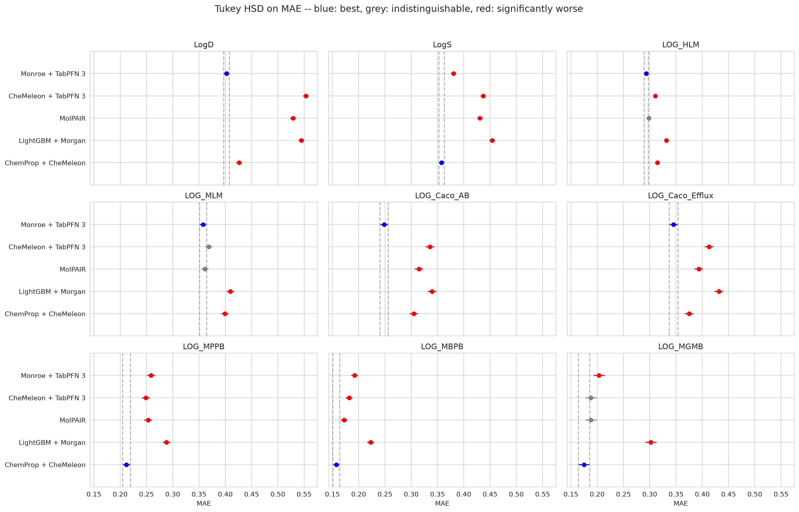

# molpair

[MolPAIR](https://arxiv.org/abs/2609.38744) corrects one tabular foundation model
with another. A global TabPFN 3 reads a frozen CheMeleon fingerprint of each
molecule and predicts the endpoint in context. A second TabPFN 3, the relation
model, is shown pairs of training molecules and learns how the first model's
error changes from one molecule to a similar one. Each test molecule then
borrows the known errors of up to 32 similar training molecules, shifted by the
predicted difference, and the global prediction is corrected by their weighted
mean. The paper reports the correction improving its own global baseline on 46
of 58 MoleculeACE and Polaris tasks.

This study puts it on the same molecules, folds and statistics as everything
else in the repository, beside the arms it would have to beat to be worth
using: LightGBM on Morgan counts, ChemProp fine-tuned from CheMeleon, and
Monroe + TabPFN 3.

The paper's own claim replicates. Against the prediction it corrects —
CheMeleon + TabPFN 3, its first stage — MolPAIR is significantly ahead on 41 of
45 endpoint × metric combinations and behind on 2, both on ExpansionRx mouse
plasma binding. It improves 51–66% of individual test predictions, close to the
55–57% the paper reports. It also holds on the test molecules the paper's own
split would have kept (nearest training molecule at Tanimoto ≤ 0.60): 11
endpoints won, 1 lost, though the gain there is about half what it is among
close analogues.

But it is a small lever. The correction is worth a median +0.024 R² per
endpoint; fine-tuning CheMeleon instead is worth +0.047, and reading Monroe's
embedding instead of CheMeleon's is worth +0.129. MolPAIR beats LightGBM on
Morgan counts on 44 of 45, but loses to fine-tuned CheMeleon on 30 and to
Monroe + TabPFN 3 on 34. Its wins over fine-tuned CheMeleon are on exactly the
four endpoints where fine-tuning did worse than freezing the encoder, and its
wins over Monroe on exactly the three where Monroe's embedding is worse than
CheMeleon's. The representation, not the correction, decides who comes out on
top.

The report is at
[docs/reports/molpair.html](../../docs/reports/molpair.html), or on the
[web](https://patwalters.github.io/model-validation-central/reports/molpair.html).
It is listed on the site index from this study's `study.json`, but it does not
enter the cross-study table, which pools only the arms `site/overview.py` names.
`06_build_page.py` publishes the page directly.



## What was compared

| Method | What it is | Where it comes from |
| --- | --- | --- |
| `lgbm` | LightGBM on Morgan counts, the floor | imported |
| `chemprop_st`, `chemprop` | the two from-scratch D-MPNN reference arms | imported, for the site overview only |
| `chemeleon` | multitask D-MPNN initialised from CheMeleon, fine-tuned | imported |
| `monroe` | Monroe's frozen embedding read by TabPFN 3 | imported |
| `molpair_global` | CheMeleon's frozen fingerprint read by TabPFN 3 — MolPAIR's first stage | fitted here |
| `molpair` | the full method: `molpair_global` plus the gated pair correction | fitted here |

`molpair_global` is not an extra arm. It is the prediction MolPAIR corrects,
returned by the same call, and the paper's "global baseline". `molpair` against
`molpair_global` is therefore the paper's own central comparison, and isolates
what the relation stage adds and nothing else.

## A reimplementation

The paper's code link, github.com/nums-ai/MolPAIR, does not resolve: the
`nums-ai` organisation has no such repository and nothing is on PyPI. So
`molpair.py` is written from the paper's Section 3 and Appendix A, and every
setting the paper states is used as stated (`MOLPAIR` in `config.py`):

| Setting | Value |
| --- | --- |
| Global representation | CheMeleon, 2,048-d, at most 2,000 kept by variance after median imputation and a constant filter |
| Relation representation | RDKit 2D descriptors, signed and absolute differences, at most 996 each |
| Backbone | TabPFN 3 for both models, 8 estimators, `tabpfn` 8.3 |
| Out-of-fold errors | 5 folds inside the training set |
| Training anchors | up to 8 per molecule, same OOF fold, matched pairs first, then Morgan Tanimoto |
| Relation context | at most 8,192 pair rows, subsampled with the fold seed |
| Query anchors | up to 32, Morgan radius 2 Tanimoto ≥ 0.20, matched pairs first |
| Pair features | Δφ, \|Δφ\|, similarity, shared Murcko scaffold, matched pair, μ_a, μ_b, μ_b − μ_a, u_a, u_b |
| Uncertainty | (Q0.9 − Q0.1) / 2.563 from TabPFN's deciles |
| Aggregation | antisymmetric, d = (P(z_aq) − P(z_qa)) / 2; weights s² / u_R |
| Gate | λ = clip((max s − 0.2) / 0.8, 0, 1) |
| Relation seed | global seed + 104,729 |

Four things the paper leaves open were settled as follows:

- **Matched pairs.** Exact one-cut Hussain–Rea pairs: one acyclic single bond
  cut, the larger side the constant part, the variable part at most ten heavy
  atoms and smaller than the constant, mmpdb's defaults. Hydrogen replacements
  are not included.
- **Morgan length.** The paper gives radius 2 and no length; 2,048 bits, as
  everywhere else here.
- **Inner folds.** The paper says five folds and nothing more; `KFold` with
  shuffling, seeded by the fold seed.
- **Relation-model caching.** The relation model predicts tens of thousands of
  pair rows per fold in 8,192-row batches against one context. It runs with
  TabPFN's `fit_with_cache`, which encodes the context once instead of once per
  batch. Tested against the default mode the outputs agree to floating-point
  precision, 0.006 at most on a unit-variance target, and it halves the run time.

Nothing is tuned. The fit and test masks are the ones every other arm in the
project uses: the four fifths of `ds == 'train'` outside the held-out fold that
have a value for the endpoint, scored on every `ds == 'test'` molecule that has
one. MolPAIR's inner folds are taken inside those four fifths, and nothing it
fits — imputation, feature selection, either TabPFN context — sees a test label.

## The split is not the paper's

The paper's primary split holds out Bemis–Murcko scaffold groups and then drops
every test molecule more similar than Tanimoto 0.60 to any training molecule.
The splits here are the project's: BitBIRCH clusters held out whole, no
similarity cutoff. So the test sets here contain close analogues the paper's
would have removed, and that is the regime a correction from similar molecules
should be strongest in, not weakest. `05_summary.py` scores the correction
separately on the test molecules the paper's protocol would have kept and on
the rest, so the page can say which regime any gain comes from.

## Running it

Everything runs on the GPU box (apollo, an RTX 5070 Ti, 16 GB), in three
environments:

```bash
# The molecule table, the folds and the imported arms, from the source study
for ds in expansion biogen; do
  ADME_DATASET=$ds ADME_SOURCE_REPO=~/MOLPAIR_SOURCE python 00_import_baselines.py
done

# Features in `chemprop` (chemprop 2.3 + RDKit), folds in `monroe` (tabpfn 8.3,
# which loads TabPFN 3). TABPFN_TOKEN is read from ~/.cache/tabpfn/auth_token.
nohup ./run_molpair.sh >> logs/molpair.log 2>&1 &

# The report, in any environment with requirements.txt (`ptgin` on apollo)
for ds in expansion biogen; do
  ADME_DATASET=$ds python 03_collect_metrics.py     # -> fold_metrics.csv
  ADME_DATASET=$ds python 04_report.py              # Tukey, paired, delta figures
done
python 05_summary.py                                # MolPAIR against every arm
python 06_build_page.py    # -> results/report.html and docs/reports/molpair.html
```

Every fold is a resume point. The CheMeleon weights are chemprop's own
foundation checkpoint, fetched from
[Zenodo](https://zenodo.org/records/15460715) to `~/.chemprop/chemeleon_mp.pt`;
TabPFN 3's are licence-gated by Prior Labs. Nothing is vendored.

## What it costs

On one RTX 5070 Ti, 375 folds, each fitting seven TabPFN 3 models and
predicting every query–anchor pair in both directions:

| Data set | Folds | Median s / fold | Slowest fold, s | Total |
| --- | --- | --- | --- | --- |
| Biogen ADME | 150 | 60 | 79 | 1.9 h |
| ExpansionRx | 225 | 104 | 231 | 5.9 h |

Almost all of it is the relation model. For comparison the Monroe + TabPFN 3
arm's 225 ExpansionRx folds took 14 minutes on the same card.
