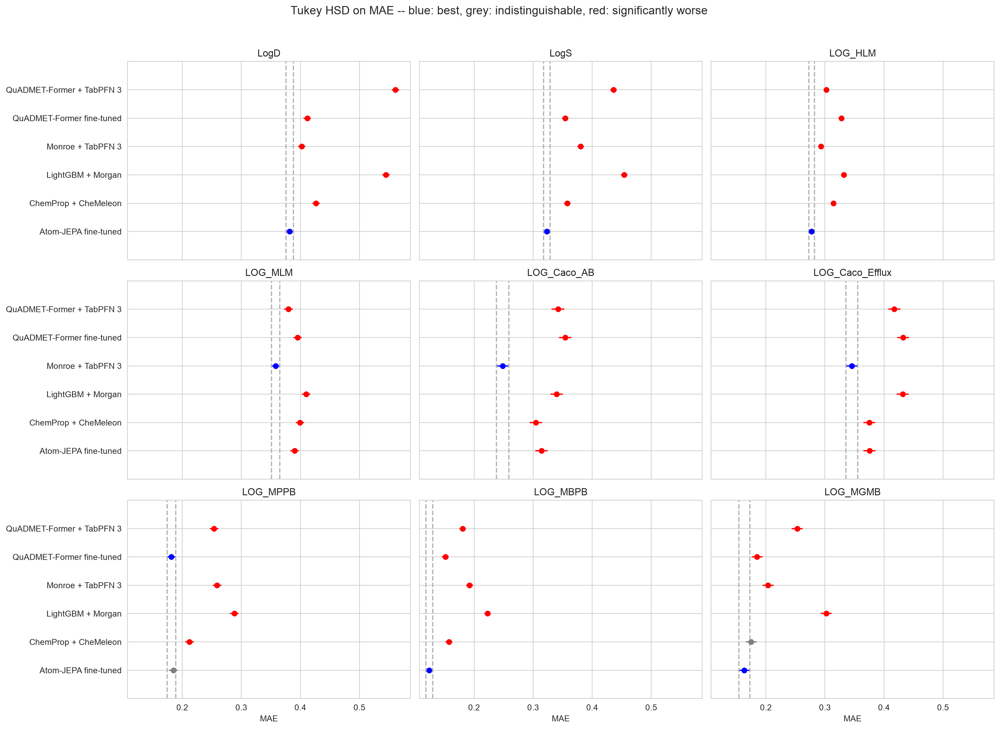

# quadmet-former

[QuADMET-Former](https://doi.org/10.26434/chemrxiv.15002429/v3) (Raja *et al.*,
*ChemRxiv* 2026) pre-trains a 1.3 M-parameter, 6-layer TorchMD-ET SE(3)-equivariant
transformer on PubChemQC quantum mechanical (QM) properties — total energy (`TE`),
HOMO–LUMO gap (`HL`), dipole moment (`DM`), 3D E3FP fingerprints (`3D`), and
per-atom Löwdin partial charges (`Lw`) — across ten released single- and
three-conformer checkpoints, then adapts the encoder to downstream ADMET tasks
via two-stage linear probing followed by end-to-end fine-tuning (`LP-FT`).

This study benchmarks QuADMET-Former on the exact same molecules, 3D conformers,
5×5 cross-validation folds, and held-out test sets as the rest of
`model-validation-central`, comparing both its fine-tuned arm (`quadmet_ft`) and
its frozen embedding read by TabPFN 3 (`quadmet_tabpfn`) against:

- `lgbm` (`LightGBM + Morgan`, the classical fingerprint floor)
- `chemeleon` (`ChemProp + CheMeleon`, the strongest 2D pre-trained message-passing arm)
- `monroe` (`Monroe + TabPFN 3`, the strongest frozen foundation model read in context)
- `atomjepa_ft` (`Atom-JEPA fine-tuned`, the 39M-parameter 3D EquiformerV3 pre-trained by masked latent prediction on 19M conformers)

The self-contained HTML report is generated by `08_build_page.py` and written to
[docs/reports/quadmet-former.html](../../docs/reports/quadmet-former.html) and
`results/report.html`.



## What was compared

| Method | What it is | Where it comes from |
| --- | --- | --- |
| `lgbm` | LightGBM on 2,048-bit Morgan counts, the floor | imported (`00_import_baselines.py`) |
| `chemprop_st`, `chemprop` | single-task and multitask D-MPNN from scratch | imported, for cross-study tables |
| `chemeleon` | multitask D-MPNN initialised from CheMeleon, fine-tuned | imported (`00_import_baselines.py`) |
| `monroe` | Monroe's frozen embedding read by TabPFN 3 | imported (`00_import_baselines.py`) |
| `atomjepa_ft` | Atom-JEPA 39M EquiformerV3 fine-tuned on 10 conformers | imported (`00_import_baselines.py`) |
| `quadmet_tabpfn` | QuADMET-Former's frozen 128-D embedding read by TabPFN 3 | fitted here (`03_run_tabpfn.py`) |
| `quadmet_ft` | the paper's arm: two-stage `LP-FT` on the chosen checkpoint | fitted here (`04_run_finetune.py`) |

## The ten released checkpoints

All ten checkpoints released by the authors on Hugging Face
([arunraja/quadmetformer-checkpoints](https://huggingface.co/arunraja)) are
6-layer, 128-channel `TorchMD_ET` backbones (`1,312,268` parameters):

| Key | Label | Pre-training conformers | Pre-training QM targets |
| --- | --- | --- | --- |
| `single_lw` | `Single [Lw]` | 1 | Löwdin atomic charges |
| `single_3d` | `Single [3D]` | 1 | 3D E3FP fingerprint (1024-bit) |
| `single_dm_hl_te` | `Single [DM,HL,TE]` | 1 | Dipole moment, HOMO–LUMO gap, total energy |
| `single_lw_dm_hl_te` | `Single [Lw,DM,HL,TE]` | 1 | Dipole moment, HOMO–LUMO gap, total energy, Löwdin charges |
| `single_all` | `Single [All]` | 1 | All five targets (`DM`, `HL`, `TE`, `3D`, `Lw`) |
| `multi_lw` | `Multi [Lw]` | 3 | Löwdin atomic charges |
| `multi_3d` | `Multi [3D]` | 3 | 3D E3FP fingerprint (1024-bit) |
| `multi_dm_hl_te` | `Multi [DM,HL,TE]` | 3 | Dipole moment, HOMO–LUMO gap, total energy |
| `multi_lw_dm_hl_te` | `Multi [Lw,DM,HL,TE]` | 3 | Dipole moment, HOMO–LUMO gap, total energy, Löwdin charges |
| `multi_all` | `Multi [All]` | 3 | All five targets (`DM`, `HL`, `TE`, `3D`, `Lw`) |

As in `studies/ecfp-pretrain`, `03_run_tabpfn.py --select` scores all ten
checkpoints on the held-out validation fifth of each training fold (25 validation
fifths per endpoint) and picks the checkpoint with the highest mean validation
$R^2$ per endpoint (`results/<ds>/quadmet_choice.csv`) before touching the test set.

## Six paper-vs-code findings in `arunraja-hub/quadmetformer`

Auditing [arunraja-hub/quadmetformer](https://github.com/arunraja-hub/quadmetformer)
revealed six issues that affect direct reproduction from the repository:

1. **Missing module on import (`models/torchmdnet.py:10`).** `from models.conformerAttention import *`
   imports a module absent from the repository; shimmed in `torchmd_backbone.py`.
2. **Unused periodic-table atom descriptors (`models/torchmdnet.py:374`).** Section 3.2
   describes an 8-dimensional periodic-table atom feature vector `data.x`, but
   `TorchMD_ET.encode` only reads `data.atomic_numbers` and `data.pos`.
3. **Layer truncation and untrained `out_norm` (`downstream_train.py:289`, `trainer.py:464–470`).**
   All ten released checkpoints have 6 attention layers (`1,312,268` parameters), and
   `self.out_norm` (`LayerNorm(128)`) is never called on the molecular path during
   pre-training. Downstream, `downstream_train.py` restricts Optuna to `num_layers ∈ {1, 2, 3}`,
   discarding layers 3–5, and `trainer.py` omits `out_norm` from the `lpft` optimizer.
4. **Untrained random layers in multi-conformer downstream mode (`models/torchmdnet.py:217–225, 456–494`).**
   Setting `multiple_conformer=True` downstream inserts randomly initialised
   `attention_weights` (`384→128→3`) and `projection_layer` (`128→128`) before
   `MeanAggregation` even during `linear_probe`. In addition, `smiles_single_conf` uses
   `AllChem.EmbedMolecule(..., useRandomCoords=True)` without MMFF94 relaxation.
5. **Evaluating the early-stopped epoch (`downstream_train.py:446`).** `trainer.test(final_model, graph_test_loader)`
   is called without `ckpt_path="best"`, scoring the weights 10 epochs after best validation loss.
6. **Sign inversion on Biogen hPPB in Table 2 (`finetuning/pearsonr_summary.html`).** In the
   committed HTML summary table, all four Biogen `plasma_protein_binding_human` test Pearson *r*
   values are negative (`-0.2074`, `-0.2948`, `-0.1369`, `-0.2951`), whereas Table 2 prints
   them as positive (`0.207`, `0.295`, `0.137`, `0.295`).

## Reproducing the pipeline

```bash
for ds in expansion biogen; do
  ADME_DATASET=$ds python 00_import_baselines.py
  ADME_DATASET=$ds python 01_conformers.py
  ADME_DATASET=$ds python 02_embed.py
  ADME_DATASET=$ds python 03_run_tabpfn.py --select
  ADME_DATASET=$ds python 04b_quadmet_selection.py
  ADME_DATASET=$ds python 03_run_tabpfn.py
  ADME_DATASET=$ds python 04_run_finetune.py
  ADME_DATASET=$ds python 04_run_finetune.py --scratch --repeat 0 --epochs 12
  ADME_DATASET=$ds python 05_collect_metrics.py
  ADME_DATASET=$ds python 06_report.py
done
python 07_summary.py
python 08_build_page.py
```

## Licence

The study's code is MIT; see [LICENSE](LICENSE).
