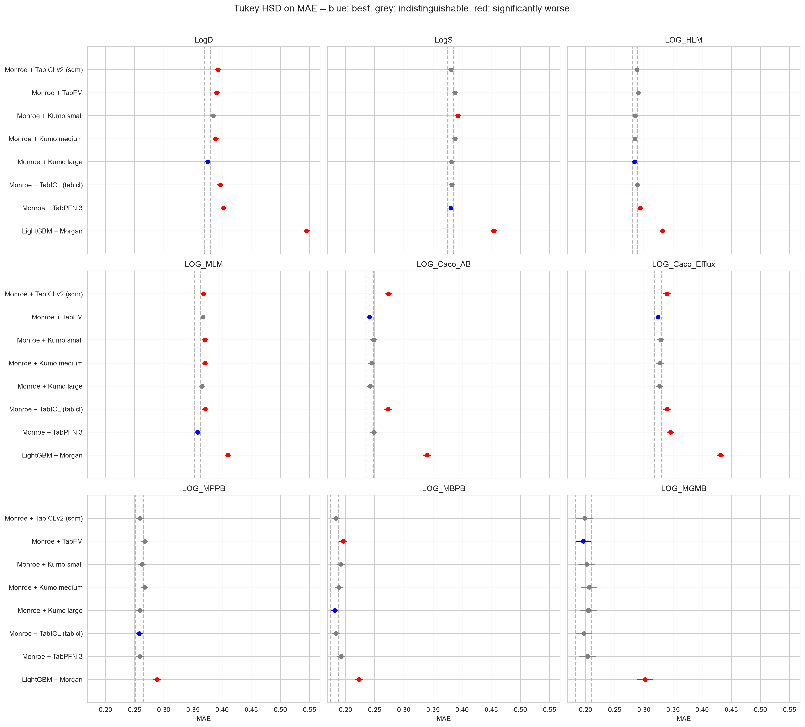

# sdm-tabular

NVIDIA's [structured-data-models](https://github.com/NVIDIA/structured-data-models)
package puts several tabular foundation models behind one in-context interface.
Each one is the same kind of object as the TabPFN head in the strongest arm of
[`expansion-ml-comparison`](../expansion-ml-comparison/): handed a table of labelled
rows and a table of unlabelled ones, it predicts the second from the first in one
forward pass, with no weights updated.

So this study holds the representation fixed and swaps the head. Every arm reads
the same frozen 720-d Monroe embedding of each molecule, on the same 5×5 folds and
the same held-out test sets as every other study here, and is scored against
**Monroe + TabPFN 3**, the configuration the Monroe paper was written against.

Kumo Tabular large is the best head. After Tukey's correction it is on top of all
45 endpoint × metric combinations across the two data sets, the only arm never
significantly worse than the best. In paired tests it is ahead of the reference on
28 and behind on 6, and ahead of the 1.6-billion-parameter TabFM on 28 against 7,
for an eighth of the GPU time. NVIDIA's TabICLv2 port reproduces the upstream
`tabicl` package to within 0.008 R², and both trail the reference, mostly on
Biogen. But the head is the small lever: swapping among these models moves R² by a
median of 0.042 per endpoint, against 0.208 for the reference's lead over LightGBM
on Morgan fingerprints.

The report is at
[docs/reports/sdm-tabular.html](../../docs/reports/sdm-tabular.html), or on the
[web](https://patwalters.github.io/model-validation-central/reports/sdm-tabular.html).
It is a standalone page, not one of the cards on the site index: this study has no
`study.json`, so `site/build_site.py` leaves it alone, and it does not enter the
cross-study table. `05_build_page.py` publishes it directly.



## What was compared

| Method | Head on Monroe's embedding | Where it comes from |
| --- | --- | --- |
| `lgbm` | — LightGBM on Morgan counts, the floor | imported |
| `chemprop_st`, `chemprop`, `chemeleon` | — the three D-MPNN reference arms | imported, for the site overview only |
| `monroe` | TabPFN 3, **the reference** | imported |
| `monroe_tabicl` | TabICL, the authors' `tabicl` 2.1.1 package | imported |
| `sdm_tabiclv2` | TabICLv2 through `sdm` | fitted here |
| `sdm_kumo_small` | Kumo Tabular small, 28 M parameters | fitted here |
| `sdm_kumo_medium` | Kumo Tabular medium, 63 M | fitted here |
| `sdm_kumo_large` | Kumo Tabular large, 216 M | fitted here |
| `sdm_tabfm` | TabFM, 1.6 B | fitted here |

The package also ships TimesFM 3, a time-series forecaster, and Kumo Relational, a
model over linked tables. Neither applies to one table of molecules with one
numeric target, so neither is an arm.

`monroe_tabicl` and `sdm_tabiclv2` load the same checkpoint,
`tabicl-regressor-v2-20260212.ckpt`, through two implementations. That pair is the
control: it tests NVIDIA's port rather than the model. They agree to within
0.008 R² on every endpoint.

## How each head is run

Nothing is tuned. Each model runs at the ensemble size and autocast precision
NVIDIA's own TabArena adapter (`benchmark/tabular/model.py` in their repository)
uses for it, with its own `default_recipe()` preprocessing:

| Model | Estimators | Precision |
| --- | --- | --- |
| TabICLv2 | 8 | float16 |
| Kumo small, medium | 8 | float16 |
| Kumo large | 16 | float16 |
| TabFM | 32 | bfloat16 |

The point prediction is what that adapter returns for regression: the mean over
the model's outputs after the recipe has averaged the ensemble. For TabICLv2 and
Kumo those are 999 quantiles, so it is the mean of the predictive distribution —
the same `output_type="mean"` the TabPFN reference uses. TabFM predicts one value.

Kumo and TabFM keep at most 500 feature columns per ensemble member, shuffled
differently for each member, so no single member sees all 720 dimensions.

The fit and test masks are the ones every other arm in the project uses: the four
fifths of `ds == 'train'` outside the held-out fold that have a value for the
endpoint, scored on every `ds == 'test'` molecule that has one. The held-out fifth
is unused, since there is no training loop to stop.

A fold run on an otherwise idle GPU is bit-for-bit reproducible.

## Running it

The heads need a CUDA machine. On the GPU box (apollo, an RTX 5070 Ti, 16 GB):

```bash
conda create -n sdm python=3.12
pip install --index-url https://download.pytorch.org/whl/cu130 torch
pip install git+https://github.com/NVIDIA/structured-data-models.git   # run at 5d66336
pip install pandas scikit-learn scipy pyarrow

# The molecule table, the folds and the Monroe embeddings, from the source study
for ds in expansion biogen; do
  ADME_DATASET=$ds ADME_SOURCE_REPO=~/EXPANSION_ML_COMPARISON \
    python 00_import_baselines.py --inputs-only
done

nohup ./run_sdm.sh >> logs/sdm.log 2>&1 &                          # four heads
PYTORCH_CUDA_ALLOC_CONF=expandable_segments:True \
  ACCEPT_TABFM_LICENSE=1 nohup ./run_sdm.sh >> logs/sdm.log 2>&1 &  # and TabFM
```

Every fold is a resume point. The checkpoints come from the Hugging Face Hub on
first use; nothing is vendored.

TabFM's weights are under Google's
[TabFM Non-Commercial License v1.0](https://huggingface.co/google/tabfm-1.0.0-pytorch/blob/main/LICENSE),
and `sdm` will not download them until it is accepted. The licence counts
benchmarking on public data as non-commercial use, and it was accepted for this
study on that basis. `01_run_sdm.py` refuses to load TabFM without
`--accept-tabfm-license`.

TabFM is also the one model that can run out of memory on 16 GB, on the largest
ExpansionRx folds. `--query-chunk N` predicts the test rows `N` at a time. A
query row attends only to the context, never to another query row, and the
generator is reseeded for each chunk, so a chunked fold is the unchunked one up to
half-precision rounding — at most 3e-3 on a 6.9-unit LogD range in testing.
`01_run_sdm.py` tries one pass first and falls back to smaller chunks only
on an out-of-memory error, recording the chunk size of every fold in `timing.csv`.
In the run reported here that happened on exactly two endpoints, ExpansionRx LogD
and LogS, all 25 folds of each at 1,024. Every other fold of every head is one
pass. Set `PYTORCH_CUDA_ALLOC_CONF=expandable_segments:True` for TabFM; without it
fragmentation runs LogD out of memory even when chunked.

Then, back on a machine with the report environment (`requirements.txt`) and the
predictions synced over:

```bash
for ds in expansion biogen; do
  ADME_DATASET=$ds python 00_import_baselines.py    # the six imported arms
  ADME_DATASET=$ds python 02_collect_metrics.py     # -> fold_metrics.csv
  ADME_DATASET=$ds python 03_report.py              # Tukey, paired, delta figures
done
python 04_head_summary.py                           # every head vs the reference
python 05_build_page.py      # -> results/report.html and docs/reports/sdm-tabular.html
```

## What each phase costs

On one RTX 5070 Ti, all 375 folds across both data sets:

| Head | Median s / fold | Total |
| --- | --- | --- |
| Kumo small | 1.6 | 10 min |
| TabICLv2 | 2.8 | 18 min |
| Kumo medium | 5.1 | 33 min |
| Kumo large | 10.4 | 68 min |
| TabFM | 63 | 9.6 h |
