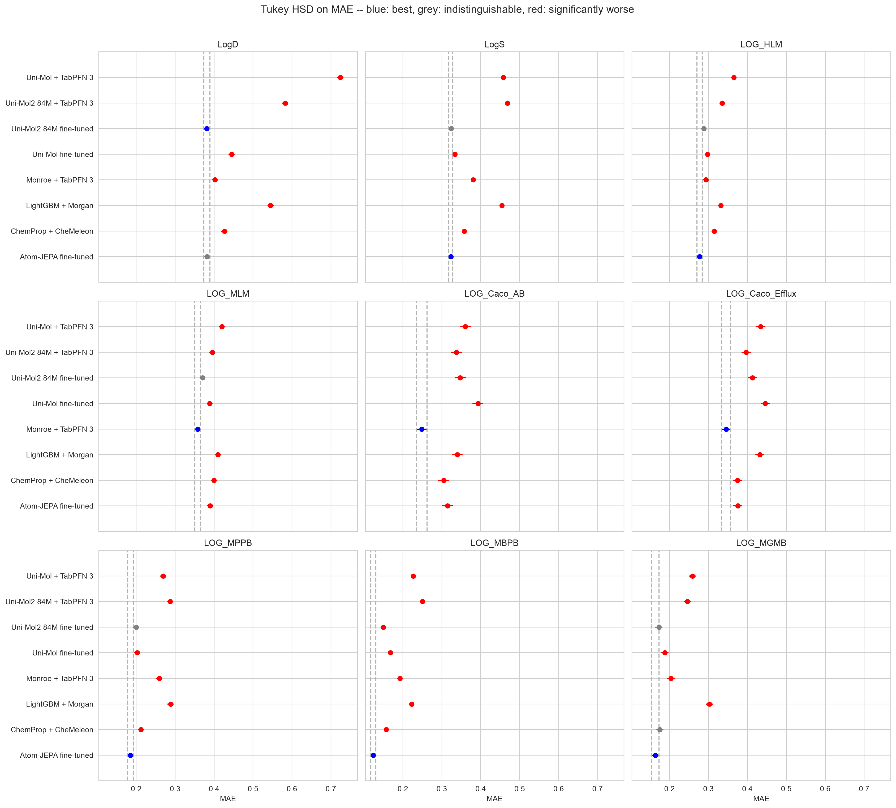

# unimol

[Uni-Mol](https://openreview.net/forum?id=6K2RM6wVqKu) (Zhou *et al.*, ICLR 2023)
pre-trains a 3D SE(3)-invariant transformer on 209M RDKit conformers by masked-atom
prediction and coordinate denoising. [Uni-Mol2](https://arxiv.org/abs/2406.14969)
(Ji *et al.*, NeurIPS 2024) scales the idea to a two-track atom/pair transformer and
reports downstream error falling as the model grows from 84M to 1.1B parameters.
Both are distributed with a fine-tuning package, `unimol_tools`, and that is how
most people meet them.

This study runs both through `unimol_tools` 0.1.5 at its defaults, on the same
molecules, 5×5 cross-validation folds and held-out test sets as the rest of
`model-validation-central`, in two ways each:

- fine-tuned (`unimol`, `unimol2`), the package's own multitask recipe
- frozen (`unimol_tabpfn`, `unimol2_tabpfn`), the package's CLS vector read by
  TabPFN 3 with Monroe's exact call

against `lgbm` (LightGBM + Morgan), `chemeleon` (ChemProp + CheMeleon, fine-tuned),
`monroe` (Monroe + TabPFN 3) and `atomjepa_ft` (Atom-JEPA, fine-tuned).

The self-contained HTML report is generated by `06_build_page.py` and written to
[docs/reports/unimol.html](../../docs/reports/unimol.html) and `results/report.html`.



## What came out

- Fine-tuned Uni-Mol2 84M beats fine-tuned Uni-Mol 30–12–3 (wins–no call–losses
  over 45 endpoint × metric paired t-tests), fine-tuned CheMeleon 31–8–6 and
  LightGBM 42–3–0.
- On ExpansionRx it is in the top Tukey tier on 14 of 27 combinations, never alone,
  and splits with Monroe + TabPFN 3 (14–5–8). On Biogen it loses all 18 calls to
  Monroe and is on top of none.
- It trails fine-tuned Atom-JEPA 3–6–36.
- Frozen under TabPFN 3, neither Uni-Mol vector wins a call against Monroe's
  (0–0–45 for both). Fine-tuning beats the frozen arm on 40 (Uni-Mol2) and 41
  (Uni-Mol) of 45 calls.
- The fine-tuned Uni-Mol arms are about twice as variable fold to fold as fine-tuned
  Atom-JEPA, and below zero R² on the two ExpansionRx Caco-2 endpoints.

## What was compared

| Method | What it is | Where it comes from |
| --- | --- | --- |
| `lgbm` | LightGBM on 2,048-bit Morgan counts, the floor | imported (`00_import_baselines.py`) |
| `chemprop_st`, `chemprop` | single-task and multitask D-MPNN from scratch | imported, for cross-study tables |
| `chemeleon` | multitask D-MPNN initialised from CheMeleon, fine-tuned | imported |
| `monroe` | Monroe's frozen embedding read by TabPFN 3 | imported |
| `atomjepa_ft` | Atom-JEPA 39M EquiformerV3, fine-tuned | imported |
| `unimol` | Uni-Mol (`mol_pre_all_h_220816`) fine-tuned with `MolTrain` | fitted here (`01_run_unimol.py`) |
| `unimol2` | Uni-Mol2 84M fine-tuned with `MolTrain` | fitted here (`01_run_unimol.py`) |
| `unimol_tabpfn` | Uni-Mol's frozen 512-d CLS vector read by TabPFN 3 | fitted here (`05_run_unimol_tabpfn.py`) |
| `unimol2_tabpfn` | Uni-Mol2 84M's frozen 768-d CLS vector read by TabPFN 3 | fitted here (`05_run_unimol_tabpfn.py`) |

## How the Uni-Mol arms are run

**Fine-tuned.** One `MolTrain(task='multilabel_regression', split='select',
split_group_col='fold', kfold=5)` call per repeat. Given the repeat's training
molecules and the fold each is held out in, it fits one model per fold on the other
four fifths, early-stops on the held-out fifth and saves it as `model_<fold>.pth`.
One model per fold predicts every endpoint of the data set, under the package's
NaN-masked L1 loss. Package defaults throughout: Adam at 1e-4 with 3% warm-up and
linear decay, batch 16, at most 100 epochs, patience 10, gradient clipping at 5,
mixed precision, hydrogens kept, one RDKit conformer per molecule from the package.
One seed per repeat.

Two departures, both needed for the protocol:

- `target_normalize='standard'`. The default `'auto'` applies `log1p` to skewed
  columns; these columns are already logs and go below −1, which gives NaN.
- Each fold model predicts the test set separately, through the package's own
  `DataHub`, `Trainer` and `NNModel`, then the saved target scaler. `MolPredict`
  would average the five fold models, leaving 5 test scores per endpoint, not 25.

**Frozen.** `UniMolRepr(...).get_repr(smiles)` gives one CLS vector per molecule
from the same conformers (`--embed`). Each fold's training vectors then go to
`TabPFNRegressor(n_estimators=8, softmax_temperature=0.9)` with the mean as the point
estimate and no PCA, which is exactly what Monroe's `fit_predict_tabpfn` does with
its default ensemble. The fit and test rows use the same masks as LightGBM and Monroe.

## Caveats

- **Target scaler.** `unimol_tools/data/datahub.py` fits the `TargetScaler` on all
  of the training data handed to `MolTrain`, before the folds are split. Each fold's
  held-out fifth therefore helps set the standardisation the model trains and
  early-stops in. The test set is never involved, so test scores are unaffected.
- **Uni-Mol2 310M dropped.** The 84M model already peaks near 13 GB at batch 16 on
  the 16 GB RTX 5070 Ti, so 310M does not fit at the package's batch size, and the
  GB10 runs Uni-Mol2 about 3× slower.
- **One conformer.** The package generates a single RDKit conformer per molecule;
  Atom-JEPA's arm used ten. This is the package's default, not a tuned choice.
- **Hardware split.** Uni-Mol2 folds ran on both an RTX 5070 Ti (`apollo`) and a GB10
  (`spark`), split by repeat, and an arm's 25 folds are pooled whichever machine ran them;
  the cost table reports the two separately.

## Reproducing the pipeline

Data and folds are imported from `expansion-ml-comparison` with the baseline
predictions. Fine-tuning and embedding need the `unimol_tools` environment;
the TabPFN step needs `tabpfn` 8.x, which loads TabPFN 3, and its licence-gated
weights.

```bash
for ds in expansion biogen; do
  ADME_DATASET=$ds python 00_import_baselines.py
  for arm in unimol unimol2; do
    ADME_DATASET=$ds python 01_run_unimol.py --arm $arm
    ADME_DATASET=$ds python 05_run_unimol_tabpfn.py --embed --arm $arm
    ADME_DATASET=$ds python 05_run_unimol_tabpfn.py --arm $arm
  done
  ADME_DATASET=$ds python 02_collect_metrics.py
  ADME_DATASET=$ds python 03_report.py
done
python 04_summary.py
python 06_build_page.py
```

`run_unimol.sh arm:dataset:repeat ...` queues fine-tuning jobs on one machine;
every repeat is a resume point, which is how the sweep was split between two GPUs.

## Licence

The study's code is MIT; see [LICENSE](LICENSE).
